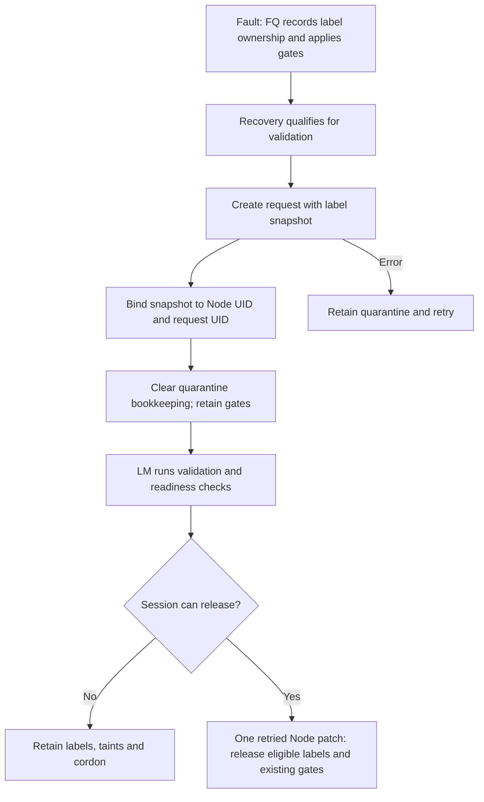

# ADR-078: Fault Management — Retain Rule Labels Through Validation

Status: Proposed for upstream review. The implementation accompanies this ADR in the same change.

## Context

Fault-quarantine can apply a rule label, a taint, and a cordon to one node. A label can represent the same scheduling gate as a taint. External controllers can read that label before they return the node to service.

When fault-quarantine creates a ValidationRequest, it keeps the taints and cordon but removes rule labels. This permits external controllers to observe a released label while validation is pending or failed. Issue #2523 describes this mismatch.

ADR-049 gives lifecycle-manager responsibility for releasing validation scheduling gates. ADR-062 keeps quarantine actions until the quarantine session ends. This proposal extends that existing release path to labels. It does not change validation routing, drain requirements, taint ownership, or readiness criteria.

Matching a label's key and value does not establish ownership. A later quarantine session can write the same value. A pre-existing label can also match the configured value.

## Decision

Retain rule labels when fault-quarantine creates a ValidationRequest. Release eligible labels through the existing lifecycle-manager scheduling-gate path, with session ownership checks.

Add an optional `schedulingGate.labels` list. Record label ownership on the Node and transfer a snapshot through ValidationRequest annotations. Do not add a controller or extend ValidationRequest spec.

## Implementation



### Configuration

Extend `SchedulingGateConfig` with optional label entries. Each entry contains a required `key`, a required `value`, and an optional `remove` boolean. The default list is empty. The default `remove` value is false.

```yaml
config:
  schedulingGate:
    cordon:
      remove: true
    taints:
      - key: example.com/fault
        value: active
        effect: NoSchedule
        remove: true
    labels:
      - key: example.com/fault
        value: active
        remove: true
```

Labels and taints need not share a key. The configuration states which gates lifecycle-manager can release. A label that is not configured for removal remains on the node.

`ValidationConfiguration` is a configuration-only type. Its generated CRD is not deployed. Regenerate the applicable deepcopy code and update configuration examples; do not invent a ValidationConfiguration CRD migration.

### Ownership

Use a versioned shared annotation format. Define constants and parsing helpers in commons. The proposed Node annotation is `nvsentinel.nvidia.com/quarantine-label-ownership`. The proposed ValidationRequest annotation is `nvsentinel.nvidia.com/quarantine-label-handoff`.

Record each label's key, value, ownership token, and pre-existing state. Mint a token for a new quarantine session. Reuse it for subsequent writes in that session. Record pre-existing state from the live Node before label application, inside the same optimistic-concurrency update. Do not replace that state on subsequent writes.

A new session replaces the ownership token even when the label value stays unchanged. A missing pre-existing marker means unknown ownership, not permission to delete. Preserve labels with unknown or pre-existing ownership.

The handoff snapshot contains a format version, the Node UID, and eligible label ownership records with session tokens. The Node binding annotation `nvsentinel.nvidia.com/quarantine-label-bindings` binds that snapshot to the actual ValidationRequest UID and name.

### Fault-quarantine handoff

1. Read the owned labels from the live Node without removing labels, taints, or cordon.
2. Create the deterministic ValidationRequest with the snapshot annotation.
3. On AlreadyExists, fetch and verify the Node UID, session identity, and snapshot before continuing.
4. Bind the Node record to the actual request UID with a conflict-protected patch.
5. Complete normal quarantine bookkeeping cleanup without deleting handed-off labels or their ownership record.

Creation failure retains quarantine state. A retry resumes an incomplete handoff. An ownership conflict retains the label instead of replacing a newer session's record. Add the snapshot after rendering so custom templates cannot omit it.

Requests that complete before handoff binding return a reconciliation error. The controller's rate-limited error retry resumes release after binding. A request whose session entry is already removed is an idempotent release retry; it does not need a consumed binding.

When no ValidationRequest is created, retain the existing label cleanup behavior. Dry-run must not change real labels or publish a real ownership handoff.

### Lifecycle-manager release

Use the existing request session, readiness checks, deletion policy, and `patchNodeWithRetry` path. Do not add a separate label-release reconcile loop.

Release a label only when the validation session becomes eligible for scheduling-gate release. Require `remove: true`, exact configured key/value matching, matching Node and request UIDs, and the matching ownership token. Read and check ownership inside the retried Node mutation. A later quarantine session, an externally changed label, or an unknown record blocks deletion of that label.

Remove eligible labels, configured taints, permitted cordon, and consumed handoff records in the same conflict-protected Node patch. Pending, running, failed, timed-out, and readiness-blocked requests do not release gates. Other outstanding session entries continue to block release. Request deletion uses the existing release criteria, not an unconditional cleanup shortcut.

### Verification

Add table-driven pure helper tests and envtest API tests. Cover pre-existing and unknown ownership, same-value new sessions, different-value updates, Node recreation, request recreation, AlreadyExists mismatches, creation failures, interrupted handoff, dry-run, and patch conflicts.

Verify that successful validation cannot release labels while another request remains pending or failed. Verify that an old request cannot delete a newer session's label. Verify that the final label, taint, and cordon changes use one Node patch.

Run relevant tests with the race detector, lint, generated-code checks, and `make lint-test-all`. Repeat key conflict and recovery cases three times. Record a separate 24-hour test-cluster observation before production readiness is claimed. Do not use a production cluster for fault injection.

## Rationale

- Labels represent the same service-return decision as other scheduling gates.
- Existing validation sessions already define the release point.
- An ownership token protects a same-value label from an older request.
- Optional configuration preserves existing taint and cordon behavior.
- Kubernetes annotations avoid a new service dependency or database migration.

## Consequences

### Positive

- Rule labels remain visible while validation blocks service return.
- Scheduling gates share one release path and one Node update.
- Pre-existing and newer-session labels remain protected.

### Negative

- Cross-component annotations become an additive persisted interface.
- Incomplete or unknown ownership can leave a label on the node.
- A handoff race needs an explicit request reconciliation trigger.

### Mitigations

- Fail closed for missing, malformed, or unknown annotation versions.
- Retain ownership metadata for inspection and return specific errors for invalid handoff records.
- Upgrade lifecycle-manager before fault-quarantine. Configure the release labels before enabling handoff.
- Do not downgrade the receiving controller while handoffs remain outstanding.
- Keep old requests readable and do not infer ownership for old annotations.

## Alternatives Considered

### Retain labels in fault-quarantine without a receiver

Rejected because lifecycle-manager cannot release the retained labels, leaving permanent gates.

### Delete every configured matching label

Rejected because a pre-existing label or a newer same-value session label can be deleted incorrectly.

### Add a separate label-release controller or state machine

Rejected because validation sessions already define the release point. Another release loop introduces conflicting writers and new failure modes.

### Add label fields to ValidationRequest spec

Not selected because an internal handoff can use additive annotations. The request spec remains a request for tests, not unrestricted label deletion.

## Notes

- This proposal does not authorize changes to existing taint ownership behavior.
- The implementation adds no external dependency. No directly applicable third-party label ownership protocol was identified; it extends the existing NVSentinel validation-session pattern.
- Upstream maintainers retain approval of this persisted protocol during PR review.
- The ADR number must be checked again before the PR is submitted.
- Effort and test-environment availability remain to be confirmed. No completed runtime verification is claimed by this draft.

## References

- [Issue #2523](https://github.com/NVIDIA/NVSentinel/issues/2523)
- [ADR-049: Node Validation](049-node-validation.md)
- [ADR-062: Release Quarantine Actions Only at Session End](062-fault-quarantine-release-at-session-end.md)
